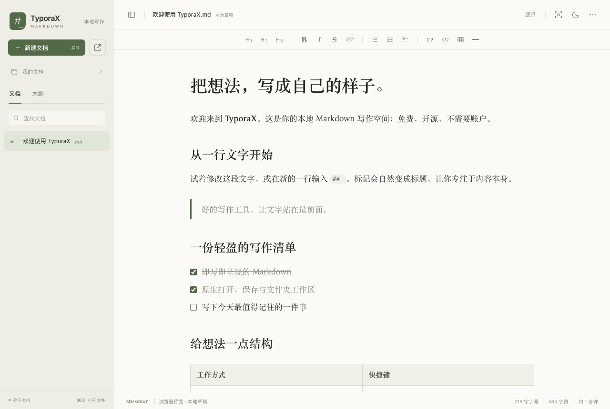

# TyporaX

免费的本地 Markdown 编辑器。用自然的可视化编辑写作，随时切换源码，文件始终由你自己保存和管理。

**macOS 14+ · 无账户 · 无订阅 · MIT 开源**



## 能做什么

- **即写即呈现**：标题、粗体、斜体、删除线、引用、列表、待办、链接、图片、表格和代码高亮。
- **源码编辑**：CodeMirror 编辑器，可视化与 Markdown 源码切换，支持两种模式下的查找替换。
- **公式与图表**：KaTeX 行内/块级公式，Mermaid 图表预览。
- **本地文件**：macOS 原生打开、保存、另存为、文件夹工作区、Finder「打开方式」。
- **安心写作**：本地草稿恢复、原子写入、保存前检查外部修改、退出时提示保存所有未保存文档。
- **写作环境**：文档列表、大纲跳转、明暗主题、专注模式、打字机模式、中英文字数统计。
- **导出**：独立 HTML 和分页 A4 PDF。插入的图片会嵌入 Markdown；已打开文件附近的相对路径图片可读取。

编辑器、字体、公式和图表资源全部随应用打包。应用不包含账户、遥测或自动上传功能；文档里的远程图片仍会访问对应网址。

## 构建与运行

需要 Node.js 22.12+（开发验证使用 Node.js 26）、npm，以及 macOS 的 Xcode Command Line Tools。

```sh
git clone git@github.com:riba2534/typorax.git
cd typorax
npm ci
npm run build:mac
open build/TyporaX.app
```

将 `build/TyporaX.app` 拖入「应用程序」即可安装，不需要 Node.js 来运行打包后的应用。默认构建当前 CPU 架构，也可以使用 `ARCH=arm64` 或 `ARCH=x86_64`。本地构建使用 ad-hoc 签名；仓库尚未配置 Apple Developer ID 签名或公证。

运行 `npm run package:mac` 可生成包含应用和安装快捷方式的 DMG，输出到 `build/`。

只预览网页界面时运行：

```sh
npm run dev
```

浏览器预览使用本地草稿与文件下载，原生文件夹和磁盘保存能力需要桌面应用。GitHub Actions 会构建网页、执行浏览器测试，并构建 macOS 应用压缩包，见 [Actions](https://github.com/riba2534/typorax/actions)。

## 使用

| 操作 | macOS 快捷键 |
| --- | --- |
| 新建 / 打开 | ⌘N / ⌘O |
| 打开文件夹 | ⌘⇧O |
| 保存 / 另存为 | ⌘S / ⌘⇧S |
| 切换源码 | ⌘/ |
| 查找与替换 | ⌘F |
| 加粗 / 斜体 / 链接 | ⌘B / ⌘I / ⌘K |
| 专注模式 | ⌘⇧F |

右上角「更多」可导出 HTML / PDF、插入图片和表格、打开打字机模式。

本地草稿会自动恢复，但**写入原 Markdown 文件需要保存**。如果文件已被其他程序修改，TyporaX 拒绝直接覆盖；可另存为新文件。重新打开时遇到磁盘与草稿冲突，会保留独立的恢复副本。

## 当前边界

这是独立实现的第一版，尚未覆盖商业编辑器的全部功能。

- 可视化模式会规范化 Markdown 排版。含 YAML/TOML 前置元数据、脚注、原生 HTML、引用式链接或部分扩展语法的文档会保留在源码模式；它们的 HTML/PDF 导出目前展示原始文本。
- 暂无多窗口、插件体系、版本历史、云同步、DOCX/Pandoc 导出或自定义主题编辑器。
- 只读取 UTF-8 文档，文件上限 32 MiB。插图上限 20 MiB。工作区最多显示 2,000 个文档，扫描最多 20,000 个条目。
- PDF 优先沿段落边界分页，超高代码块或图表可能跨页；复杂分页排版仍需检查。
- 已在 Apple Silicon Mac 上运行验证。Intel 构建入口已提供，尚未在 Intel 真机验证。中文文本编辑已测试，中文输入法候选词交互仍需人工验证。

## 项目结构

| 路径 | 内容 |
| --- | --- |
| `src/` | TypeScript 编辑器、文件状态、浏览器/原生桥接 |
| `native/` | Swift AppKit 窗口、WKWebView、文件读写与 PDF |
| `scripts/` | 构建、原创应用图标、依赖许可清单 |
| `tests/` | Playwright 行为测试 |
| `docs/typora-analysis.md` | REA 安装包观察、证据与未验证范围 |

技术栈：AppKit + WKWebView、Tiptap / ProseMirror、CodeMirror、KaTeX、Mermaid、Vite。打包后不启动本地服务器，不依赖 Electron。

## 验证

```sh
npm run build
npx playwright install chromium
npm test
npm run build:mac
build/TyporaX.app/Contents/MacOS/TyporaX --web-smoke-test
build/TyporaX.app/Contents/MacOS/TyporaX --pdf-self-test
```

构建 macOS 应用时会自动运行原生文件测试；详情见 [native/README.md](native/README.md)。测试覆盖内容往返、实际下载、源码保留、草稿恢复、原生桥接、外部修改检测和分页 PDF。

## 来源与许可

TyporaX 是独立项目，与 Typora 及其开发者无隶属关系。项目通过用户提供安装包的只读结构和菜单分析整理功能需求，未使用 Typora 的程序代码、主题、字体或图标，也未修改其授权机制。分析范围见 [报告](docs/typora-analysis.md)。

TyporaX 自有源码采用 [MIT License](LICENSE)。第三方组件保留各自许可与版权，详见 [THIRD_PARTY_NOTICES.md](THIRD_PARTY_NOTICES.md)。欢迎提交 Issue 和 Pull Request，参与方式见 [CONTRIBUTING.md](CONTRIBUTING.md)。
