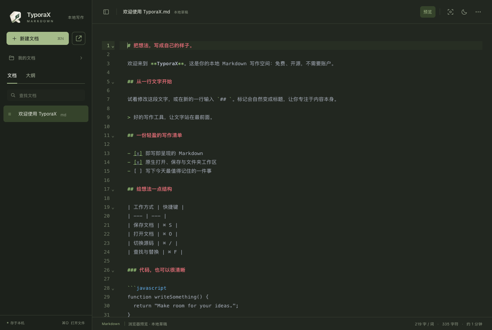
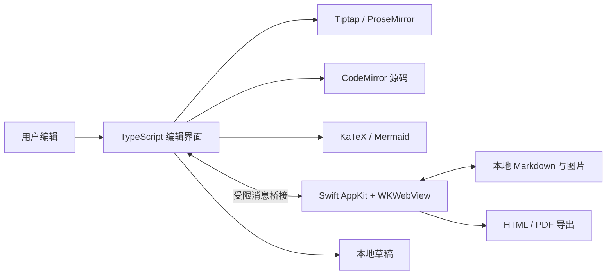

<p align="center">
  
</p>

<h1 align="center">TyporaX</h1>

<p align="center">
  <b>免费、开源、离线可用的 macOS Markdown 编辑器</b>
  <br />
  即写即呈现，随时切换源码。把注意力留给文字，把文件留在自己手里。
</p>

<p align="center">
  <a href="https://github.com/riba2534/typorax/releases/latest"></a>
  <a href="https://github.com/riba2534/typorax/actions/workflows/ci.yml"></a>
  
  <a href="https://github.com/riba2534/typorax/stargazers"></a>
  <a href="LICENSE"></a>
</p>

<p align="center">
  <a href="#typorax-是什么">介绍</a> ·
  <a href="#功能总览">功能</a> ·
  <a href="#快速开始">下载与安装</a> ·
  <a href="#使用指南">使用指南</a> ·
  <a href="#开发与测试">开发与测试</a> ·
  <a href="#常见问题">常见问题</a> ·
  <a href="CHANGELOG.md">更新日志</a>
</p>

<p align="center">
  
</p>

---

## TyporaX 是什么

TyporaX 是一个面向 macOS 的本地 Markdown 编辑器。输入 `#`、`-`、`**文字**` 等标记后，标题、列表和加粗会直接呈现在文稿中；需要精确调整格式时，按 **⌘/** 切换源码。

它适合写技术文档、学习笔记、博客和日常记录。打开的是普通 `.md` 文件，保存的也是普通 `.md` 文件；不需要注册账户、订阅服务或把文稿上传到云端。

### 为什么使用 TyporaX

- **写作与源码兼顾** — 可视化编辑和带语法高亮的源码编辑，支持查找与替换。
- **本机文件直接管理** — 原生文件选择框、另存为、文件夹工作区与 Finder「打开方式」。
- **技术文档开箱即用** — 表格、待办、代码高亮、KaTeX 数学公式和 Mermaid 图表。
- **保护正在写的内容** — 本地草稿恢复、原子保存、外部修改检测，多文档之间的内容和撤销记录隔离。
- **离线可用** — 编辑器、字体、公式和图表资源随应用打包；无需启动本地服务器。
- **源码和构建过程公开** — MIT 许可，提供完整源码、本机验证命令及自动构建流程。

## 功能总览

| 模块 | 已实现的能力 |
| --- | --- |
| **Markdown 编辑** | 六级标题、粗体、斜体、删除线、引用、有序/无序列表、待办、分隔线、链接和图片 |
| **源码模式** | CodeMirror 编辑器、语法高亮、行号、自动换行、两种模式间切换 |
| **表格与代码** | 插入表格、编辑单元格、调整显示列宽、代码高亮和代码语言选择 |
| **公式与图表** | 行内/块级公式、点击修改公式、Mermaid 预览及 HTML/PDF 导出 |
| **文件管理** | 新建、打开、保存、另存为、文件夹文档列表、文件名筛选、大纲跳转 |
| **内容保护** | 自动保存本地草稿、退出保存提示、外部修改冲突保护、冲突草稿恢复为独立副本 |
| **写作环境** | 明暗主题、专注模式、打字机模式、字数/字符数与阅读时长 |
| **查找替换** | 查找上一个/下一个、单个替换、全部替换，支持中文 |
| **导出** | 独立 HTML、自带公式样式、图表 SVG、分页 A4 PDF |
| **macOS 集成** | 原生窗口和菜单、系统快捷键、应用图标、Markdown 文件关联 |

<details>
<summary><b>查看暗色源码模式</b></summary>



</details>

## 快速开始

### 下载安装包

1. 前往 **[Releases 下载页面](https://github.com/riba2534/typorax/releases/latest)**。
2. 下载 `TyporaX-版本号-macOS-arm64.dmg`，适用于 Apple Silicon（M 系列）Mac。
3. 打开 DMG，将 **TyporaX** 拖入 **Applications（应用程序）**。
4. 打开 TyporaX，按 **⌘N** 新建文档或 **⌘O** 打开已有文件。

**运行环境：macOS 14 或更高版本。** 安装包不需要 Node.js、npm 或 Xcode。Intel Mac 可使用下面的源码构建方式，目前不提供经过本机验收的 Intel 安装包。

发行包使用 ad-hoc 签名，尚未经过 Apple Developer ID 公证。若系统提示无法验证开发者，请检查“系统设置 → 隐私与安全性”中该应用的提示；也可从源码自行构建。无需关闭系统安全保护。

每次发布附带 `SHA256SUMS`，可在下载目录核对安装包：

```bash
shasum -a 256 -c SHA256SUMS
```

### 从源码构建

需要 Node.js 22.12+、npm 和 Xcode Command Line Tools；开发验证使用 Node.js 26。

```bash
git clone https://github.com/riba2534/typorax.git
cd typorax
npm ci
npm run build:mac
open build/TyporaX.app
```

生成 DMG：

```bash
npm run package:mac
# 输出：build/TyporaX-1.0.0-macOS-arm64.dmg
```

构建默认使用当前 Mac 的 CPU 架构。脚本支持 `ARCH=arm64` / `ARCH=x86_64`，自检仍需在能运行对应架构程序的 Mac 上执行。

## 使用指南

### 写一篇 Markdown

在空白行输入 `# ` 创建标题，输入 `- ` 创建列表，输入 `> ` 创建引用。也可以选中文字，再使用顶部工具栏设置格式。

按 **⌘/** 在可视化与源码模式之间切换。源码模式适合编辑复杂表格、长链接、公式和图表。

```markdown
# 今天的笔记

一段 **重要内容**，以及一个 [链接](https://github.com/riba2534/typorax)。

- [x] 整理思路
- [ ] 写出第一稿

行内公式：$E = mc^2$。
```

更多内容可直接打开 [示例文档](examples/Welcome.md)。

### 插入图片、公式和图表

- **图片**：右上角「更多 → 插入图片」，或拖入、粘贴图片。新插入图片以 Data URI 嵌入 Markdown；已有文档可显示当前文件夹及其子目录内的相对路径图片。
- **公式**：用 `$…$` 写行内公式，用独立的 `$$` 包裹块级公式。可视化模式下点击公式即可修改。
- **Mermaid**：使用语言为 `mermaid` 的代码块，编辑区会同时展示源码和图表。

````markdown

````

### 保存与恢复

**⌘S 写入 Markdown 文件；本地草稿恢复用于防止意外中断。** 两者分别工作，不会因为恢复草稿就自动覆盖磁盘文件。

如果其他程序修改了同一个文件，TyporaX 会拒绝直接覆盖。重新打开时，未保存的内容会保留为独立恢复副本，方便比较和另存。关闭应用时可以选择保存全部、取消或不写入磁盘。

### 快捷键

| 操作 | 快捷键 | 操作 | 快捷键 |
| --- | --- | --- | --- |
| 新建文档 | ⌘N | 打开文件 | ⌘O |
| 打开文件夹 | ⌘⇧O | 保存 | ⌘S |
| 另存为 | ⌘⇧S | 源码切换 | ⌘/ |
| 查找与替换 | ⌘F | 专注模式 | ⌘⇧F |
| 加粗 / 斜体 | ⌘B / ⌘I | 插入链接 | ⌘K |
| 撤销 / 重做 | ⌘Z / ⌘⇧Z | 导出 PDF | ⌘P |

## 系统架构



网页资源打包为离线应用内容，由系统 WKWebView 加载。原生宿主处理文件选择、授权路径、原子写入和 PDF。应用不依赖 Electron，也不运行后台 Web 服务。

```text
assets/                    原创 Logo
src/                       编辑器、文档状态、主题与桥接
native/                    macOS 窗口、文件系统、导出与原生测试
tests/                     浏览器功能回归
scripts/                   构建、图标、许可及本机验收
examples/                  可直接打开的 Markdown 示例
docs/                      兼容性、验证记录、分析和品牌说明
.github/workflows/         CI 与发布流程
```

## 开发与测试

```bash
npm ci
npm run dev               # 浏览器开发预览
```

浏览器预览支持编辑、本地草稿、打开单文件和下载。原生文件夹、磁盘保存和分页 PDF 需要桌面应用。

**先本机验证，全部通过后再提交和推送：**

```bash
npx playwright install chromium
npm run verify:local
```

这一命令会检查文档链接和版本、构建生产资源、运行浏览器功能用例、编译原生宿主、验证文件读写及真实 WKWebView 集成、检查 PDF 和签名，最后生成并校验 DMG。失败会立即停止。

- [验证记录与测试范围](docs/validation.md)
- [原生宿主与测试入口](native/README.md)
- [贡献指南](CONTRIBUTING.md)
- [发布流程](docs/releasing.md)

## 常见问题

### 文稿会上传到服务器吗？

TyporaX 没有账户、遥测或自动上传功能。文档中的远程图片会访问图片网址；打开外部链接则交给系统浏览器。

### 为什么有的文件只能使用源码模式？

含 YAML/TOML 前置元数据、脚注、原生 HTML、引用式链接等当前可视化模式不支持的结构时，TyporaX 会保留源码，避免悄悄删改内容。这类文档仍可编辑和保存，当前 HTML/PDF 导出展示原始文本。详见 [兼容性说明](docs/compatibility.md)。

### Markdown 格式会改变吗？

打开或仅切换模式不会自动重写文件。进行可视化编辑后，编辑内核会规范化列表标记、空行等排版。需要精确保留原文结构时，请使用源码模式。

### 支持哪些平台？

桌面应用支持 macOS 14+，首个发行包面向 Apple Silicon。Windows、Linux 可运行浏览器开发预览，目前没有原生桌面安装包。

### 还有哪些功能限制？

当前没有多窗口、插件体系、版本历史、云同步、DOCX/Pandoc 导出或主题编辑器；切换文档或编辑模式会重置对应视图的撤销记录。文件大小、工作区规模和 PDF 分页限制见 [兼容性说明](docs/compatibility.md)。

## 文档导航

| 文档 | 内容 |
| --- | --- |
| [使用示例](examples/Welcome.md) | 标题、待办、表格、公式和图表 |
| [兼容性说明](docs/compatibility.md) | 支持范围、文件限制和格式行为 |
| [本机验证](docs/validation.md) | 实际运行证据与尚未覆盖的范围 |
| [发布流程](docs/releasing.md) | 本机验收、版本管理、安装包和校验和 |
| [品牌资源](docs/brand/README.md) | Logo 来源、提示词和图标生成 |
| [安装包分析](docs/typora-analysis.md) | REA 观察证据和独立实现边界 |
| [第三方声明](THIRD_PARTY_NOTICES.md) | 依赖版本、版权及许可证 |

## 贡献

欢迎提交 [Issue](https://github.com/riba2534/typorax/issues) 和 Pull Request。问题反馈请附上版本、系统、复现步骤与去除个人信息的最小 Markdown 样例。

提交前请阅读 [CONTRIBUTING.md](CONTRIBUTING.md)，并在本机验证改动。不要把尚未执行的检查写成“已通过”。

## 致谢与许可

感谢 [Tiptap](https://github.com/ueberdosis/tiptap)、[ProseMirror](https://github.com/ProseMirror/prosemirror)、[CodeMirror](https://github.com/codemirror/dev)、[KaTeX](https://github.com/KaTeX/KaTeX)、[Mermaid](https://github.com/mermaid-js/mermaid) 等开源项目。

TyporaX 的自有源码采用 [MIT License](LICENSE)，第三方组件保留各自许可。TyporaX 是独立项目，与 Typora 及其开发者无隶属关系；没有使用 Typora 的程序代码、主题、字体或图标。
